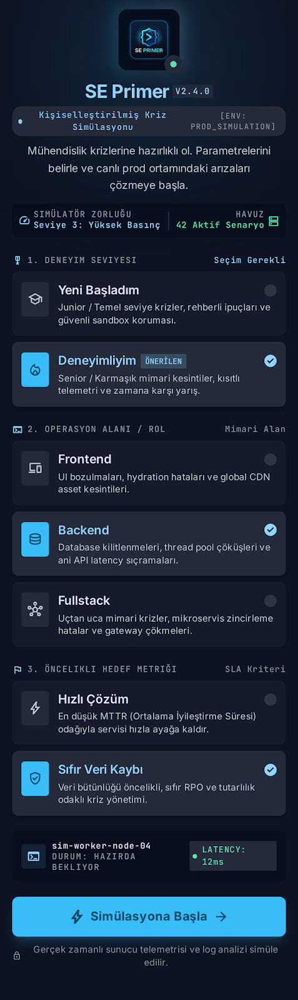
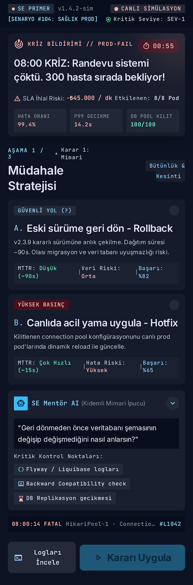
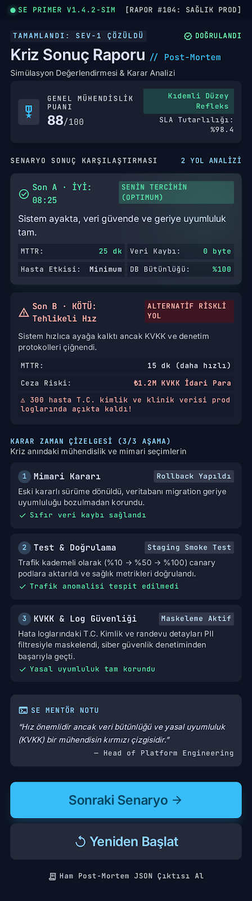

# SE Primer — Arayüz ve Deneyim Tasarım Dokümanı (`DESIGN.md`)

Bu doküman, **YZM301 SE Primer** kriz simülasyonunun **Google Stitch** üzerinden dışa aktarılmış 4 tasarım paketi (`se_primer_onboarding`, `se_primer_kriz_karar`, `se_primer_kriz_sonu_raporu`, `obsidian_terminal`) ile yerel web uygulaması arasındaki görsel mimariyi, renk/tipografi sistemini ve mobil tek el (`thumb-zone`) ergonomi kararlarını belgeler.

---

## 1. Stitch Dışa Aktarım (Export) ve `assets/screens/` Eşleştirme Yapısı

Stitch üzerinden dışa aktarılan 4 klasörlük tasarım çıktısı, proje kök dizinindeki `assets/screens/` altında standartlaştırılmış ekran görsellerine (`01_onboarding.png`, `02_crisis_decision.png`, `03_outcome_report.png`) bağlanmıştır:

| Stitch Kaynak Klasörü | Hedef Görsel Yolu | Ekran / Modül Rolü | İlgili DOM / Bileşen Karşılığı |
| :--- | :--- | :--- | :--- |
| `se_primer_onboarding/` | `assets/screens/01_onboarding.png` | Giriş, Kriz Brifingi ve 3'lü Mühendis Profil Seçimi | `#onboarding-section`, `#incident-banner` |
| `se_primer_kriz_karar/` | `assets/screens/02_crisis_decision.png` | Canlı Kriz Terminali, Karar Kartları ve Sokratik AI Tutor | `#decisions-container`, `#ai-tutor-section` |
| `se_primer_kriz_sonu_raporu/` | `assets/screens/03_outcome_report.png` | Sonuç Karnesi (Son A: İyi Son / Son B: KVKK İhlali Debrief) | `#result-card`, `#result-summary` |
| `obsidian_terminal/` | `style.css` (`:root` Design Tokens) | Tasarım Sistemi, Arduvaz Koyu Tema, Renk Paleti ve Tipografi | Global CSS Değişkenleri ve Ergonomi Kuralları |

> [!TIP]
> `node scripts/sync_stitch_assets.js` komutu çalıştırıldığında, Stitch klasörlerindeki güncel ekran çıktıları otomatik olarak `assets/screens/` dizinine senkronize edilir.

---

## 2. `obsidian_terminal` Tasarım Sistemi: Renk Paleti ve Tipografi Hiyerarşisi

### 2.1. Renk Paleti (Derin Arduvaz / Terminal Koyu Teması)
Saat **08:00'de çöken randevu sistemi ve bekleyen 300 hasta** senaryosunun operasyonel ciddiyetini yansıtmak amacıyla `obsidian_terminal` tasarım sistemi, göz yorgunluğunu azaltan **derin arduvaz (deep slate)** zemin üzerine yüksek kontrastlı semantik durum renkleri uygular:

| Kategori | Token Adı | Hex Kodu | Görsel Rolü ve Psikolojik Etkisi |
| :--- | :--- | :--- | :--- |
| **Zemin (Obsidian Slate)** | `--bg-primary` | `#0B0F19` | Ana terminal arka planı; düşük ışıkta parlamayı önleyen derin arduvaz/gece siyahı. |
| **Kart Yüzeyi** | `--bg-surface` | `#111827` | Karar kartları, Sokratik sohbet kutusu ve durum üst çubuğu için ikincil arduvaz katman. |
| **Yükseltilmiş Etkileşim** | `--bg-elevated` | `#1E293B` | `Thumb-zone` karar butonları, seçim kutuları (`select`) ve aktif terminal satırları. |
| **Kriz / Alarm Kırmızısı** | `--accent-crisis` | `#EF4444` | `HTTP 502` çöküş banner'ı, 60 sn geri sayım sayacı ve **Son B (KVKK İhlali)** vurgusu. |
| **Uyarı / Kehribar** | `--accent-warning` | `#F59E0B` | Yeni başlayanlar için **Teknik İpucu** kutuları, bekleyen hasta kuyruğu ve riskli karar (`B`) vurgusu. |
| **Başarı / Zümrüt Yeşili** | `--accent-safe` | `#10B981` | Sistemin sağlıklı ayağa kalkması, güvenli mühendislik seçimi (`A`) ve **Son A (İyi Son)** raporu. |
| **Operasyonel Mavi** | `--accent-primary` | `#3B82F6` | Birincil başlatma aksiyonu, adım etiketleri (`Karar 1/3`) ve teknik analiz başlıkları. |
| **Kenarlık & Ayırıcı** | `--border-subtle` | `#334155` | Terminal pencerelerini ve karar kartlarını birbirinden ayıran ince arduvaz kontur. |

### 2.2. Tipografi Hiyerarşisi (`Inter` & `JetBrains Mono`)
`obsidian_terminal` sisteminde bilişsel yükü azaltmak için **okuma metinleri** ile **makine/telemetri çıktıları** tipografik olarak birbirinden ayrılmıştır:

1. **Arayüz ve Pedagojik Anlatı Fontu — `Inter` (Sans-Serif):**
   - **Kriz Ana Başlığı (`H1`):** `1.4rem (22.4px)`, `700 Bold`, `line-height: 1.25` — Krizin ilk saniyesinde durumu tek bakışta özetler.
   - **Karar Aşaması Başlığı (`H2`):** `1.15rem (18.4px)`, `600 Semi-Bold` — Mimari, Test ve KVKK sorularını netleştirir.
   - **Teknik Analiz Gövdesi (`Body`):** `0.95rem (15.2px)`, `400 Regular`, `line-height: 1.6` — *"Ne oldu?"* ve *"Neden oldu?"* açıklamalarının mobil ekranda rahat okunmasını sağlar.
2. **Telemetri, Sayaç ve Log Fontu — `JetBrains Mono` (Monospace):**
   - **Kriz Saati (`08:00` -> `08:25`) ve `60s` Geri Sayım Sayacı:** `1.0rem (16px)`, `700 Bold`, sabit genişlikli (`tabular-nums`) karakterler sayesinde sayaç azalırken ekranda titreme olmaz.
   - **Canlı Sunucu Logları (`.terminal-box`):** `0.8rem (12.8px)`, `#93C5FD` buz mavisi kod rengi ile gerçek bir `stdout/stderr` konsol hissiyatı verir (`NullPointerException`, `PatientRecord` JSON dökümü).

---

## 3. Ekran Tasarımları ve Görsel Yerleşim Analizi

### 3.1. Ekran 1: Giriş ve Mühendis Profil Yapılandırması (`se_primer_onboarding`)



- **Görsel Hiyerarşi:**
  - En üstte sabitlenen (sticky) **Canlı Kriz Çubuğu**, yanıp sönen kırmızı durum noktası (`CANLI KRİZ`), `08:00` dijital saati ve `300 hasta bekliyor` uyarısıyla kullanıcıyı doğrudan senaryonun içine çeker.
  - Hemen altında kırmızı sol kenarlıklı `INC-2026-0800 · CRITICAL HTTP 502` brifing kartı yer alır.
- **3 Girdi Alanı ve Durum Tetikleyicileri:**
  1. **Seviye Seçimi (`#level-select`):** `"Yeni başladım"` seçildiğinde kehribar renkli teknik ipuçları aktifleşir; `"Deneyimliyim"` seçildiğinde üst barda kırmızı `60 sn` geri sayım sayacı devreye girer.
  2. **Rol Seçimi (`#role-select`):** `Backend`, `Frontend` veya `Fullstack` perspektifi seçilir.
  3. **Hedef Seçimi (`#goal-select`):** `Hızlı Çözüm` / `Hızlı kurtarma` veya `Sıfır veri kaybı` önceliği belirlenir.

---

### 3.2. Ekran 2: Kriz Sahnesi, Karar Kartları ve Sokratik AI Tutor (`se_primer_kriz_karar`)



- **Kriz Sahnesi Yerleşimi:**
  - **Üst Bölüm (Göz Hizası - Görsel Telemetri):** Kullanıcının dokunmasına gerek olmayan `terminal-box` log kayıtları (`AppointmentController`, `DeploymentPipeline`, `PatientRecord`) ve kehribar renkli **Teknik İpucu** kutuları ekranın üst-orta bölgesinde konumlanır.
  - **Orta-Alt Bölüm (`Thumb-Zone` Karar Butonları):** `A)` ve `B)` karar butonları başparmağın doğal erişim yayına yerleştirilmiştir. Seçim yapıldığı anda buton zümrüt yeşili (`.selected-a`) veya kehribar (`.selected-b`) konturla işaretlenir.
  - **Anlık Neden-Sonuç Paneli (`.feedback-box`):** Seçim sonrası kartın hemen altında *"📌 Ne oldu?"* ve *"🔍 Neden oldu?"* analizleri açılır.
  - **Sokratik AI Tutor Bölümü (`#ai-tutor-section`):** Hızlı soru çipleri (*"Hangisini seçeyim?"*, *"Rollback vs Canlı Yama?"*, *"KVKK ve log maskeleme?"*) ve sohbet kutusu ile öğrenciye şıkkı sızdırmadan Sokratik sorular yöneltir.

---

### 3.3. Ekran 3: Sonuç ve Kriz Sonu Raporu (`se_primer_kriz_sonu_raporu`)



- **Son A (İyi Son — Zümrüt Yeşili `#10B981` Teması):**
  - Başlık: **`Son A · İYİ: 08:25 sistem ayakta, veri güvende`**
  - Sistemin 25 dakika içinde kararlı sürüme döndüğünü, smoke test ile doğrulandığını ve loglardaki kişisel hasta verilerinin maskelenerek KVKK uyumluluğunun korunduğunu gösteren başarı karnesi.
- **Son B (Kötü Son — Alarm Kırmızısı `#EF4444` Teması):**
  - Başlık: **`Son B · KÖTÜ: Sistem ayakta ama KVKK ihlali`**
  - Sistemin ayağa kalkmasına rağmen açık hasta adı (`"Ayşe Yılmaz"`) ve T.C. kimlik numarasının maskelenmeden paylaşılması nedeniyle oluşan 6698 sayılı KVKK veri ihlali raporu.
- **Debrief Özeti ve Yeniden Başlatma:** Seçilen profil ve 3 kararın tam dökümü (`#result-summary`) ile tek dokunuşla simülasyonu sıfırlayan `"Simülasyonu Yeniden Başlat"` (`#restart-btn`) aksiyonu yer alır.

---

## 4. Mobil Tek Elle Kullanım (`Thumb-Zone`) Ergonomisi ve Yerleşim Mantığı

Mobil cihazlarda (`360px - 430px` genişlik) kullanıcıların %75'i ekranı tek elle ve başparmakla kontrol eder. `obsidian_terminal` yerleşim kararları Steven Hoober'ın **Thumb-Zone (Başparmak Erişim Haritası)** prensiplerine göre kurgulanmıştır:

```text
+---------------------------------------------------+
| [ZOR ERİŞİM ALANI - SADECE GÖRSEL TELEMETRİ]      |
| 🔴 CANLI KRİZ | Saat: 08:05 | ⏱️ Kalan Süre: 60s  | <- Sticky Üst Bar (Salt Okunur)
|---------------------------------------------------|
| [DOĞAL KAYDIRMA VE OKUMA ALANI]                   |
| >_ Terminal Logları (JetBrains Mono)              |
| 💡 Teknik İpucu Kutusu (Kehribar Vurgu)           | <- Bilişsel Bağlam Alanı
|---------------------------------------------------|
| [KOLAY ERİŞİM ALANI - THUMB ZONE (AKTİF KARAR)]   |
| +-----------------------------------------------+ |
| | [A] A) Eski sürüme geri dön  (Min 52px Yüks.) | | <- Başparmak Yayında Tam Genişlik
| +-----------------------------------------------+ |
| | [B] B) Canlıda yama yap      (Min 52px Yüks.) | | <- 12px Dikey Boşluk (Hatalı Dokunuş Önleyici)
| +-----------------------------------------------+ |
|---------------------------------------------------|
| [ALT DOCK - SOKRATİK AI TUTOR ETKİLEŞİMİ]         |
| [ Hızlı Soru Çipleri ] + [ Input ] + [ Sor Btn ]  | <- Klavye Açıldığında Yukarı İtilen Alan
+---------------------------------------------------+
```

1. **Salt Okunur Üst Kuşak (Top Zone):** Ekranın ulaşılması en güç olan en üst %15'lik dilimine hiçbir tıklanabilir buton konulmamıştır; burada yalnızca **Canlı Kriz Saati**, **300 Hasta Sayacı** ve **60 Saniyelik Geri Sayım** gibi pasif izleme bileşenleri yer alır.
2. **Minimum 48px–54px Dokunma Hedefi (Touch Target):** Tüm karar butonları (`.option-btn`), birincil başlatma butonu (`.btn-primary`) ve seçim kutuları (`select`) `0.9rem 1rem` iç boşluk (padding) ile minimum `52px` yüksekliğe sahiptir; bu sayede stresli geri sayım sırasında yanlış şıkka basma (fat-finger error) riski ortadan kaldırılmıştır.
3. **Dikey Yığınlama (Mobile Stack) vs. Masaüstü Grid:** Mobilde (`<600px`) `A` ve `B` şıkları tam genişlikte alt alta dizilerek hem sol hem sağ el başparmak erişimine eşit mesafe sunar. Masaüstünde (`>=960px`) ise sol sütunda kriz akışı, sağ sütunda yapışkan (`position: sticky`) Sokratik AI Tutor yer alır.
