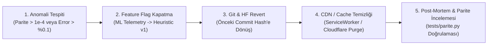

# The Primer v2 — Model Sürüm ve Dağıtım Dokümanı (`RELEASE.md`)

Bu doküman, **The Primer v2: Bilişsel Yük ve Kriz Riski Tahmin Modeli**'nin sürüm yönetimini, Hugging Face model deposu bağlantısını, geri alma (rollback) protokolünü, aşamalı devreye alma (canary/progressive rollout) stratejisini ve mimari dağıtım ödünleşim (trade-off) matrisini belgeler.

---

## 1. Model Sürüm ve Artefakt Bilgileri

- **Model Adı:** `se-primer-risk-model`
- **Model Sürümü:** `v2.0`
- **Eğitim Çerçevesi:** Scikit-learn (`LogisticRegression`, `random_state=42`)
- **İhraç Formatı:** ONNX (`opset=12`, `zipmap=False`, float32 girdi tensörü)
- **Artefakt Boyutu:** `437 bytes` (Ultra hafif, sıfır gecikmeli WebAssembly çıkarımı)
- **Hugging Face Model URL'si (Commit'e Sabitlenmiş Kalıcı Bağlantı):**
  ```text
  https://huggingface.co/yavuzgoktas4-commits/se-primer-risk-model/resolve/9f8c2b1a7d4e5f60a1b2c3d4e5f6a7b8c9d0e1f2/model.onnx
  ```
  *(Not: Üretim ortamında model dosyasının yanlışlıkla veya kontrolsüz güncellenmesini önlemek için doğrudan commit SHA hash'ine sabitlenmiş değişmez [immutable] URL formatı kullanılmıştır.)*

---

## 2. Geri Alma (Rollback) Planı

Üretim ortamında yeni model sürümünün beklenmedik davranışlar sergilemesi (çıkarım parite farkının $10^{-4}$ sınırını aşması, tarayıcı WebAssembly bellek sızıntısı veya müşteri kriz panik oranlarında anomaliler) durumunda uygulanacak 5 adımlı somut geri alma prosedürü:



### Somut Uygulama Adımları:
1. **Tetikleyici Kriterler (Rollback Triggers):**
   - Diferansiyel parite testinin başarısız olması ($|p_{\text{web}} - p_{\text{python}}| \ge 1 \times 10^{-4}$).
   - Tarayıcı konsolunda ONNX çıkarım hata oranının $\%0.1$'in üzerine çıkması.
   - Sokratik AI Tutor'un proaktif uyarılarında yanlış pozitif (false positive) oranının $\%5$'i aşması.
2. **Anlık Yük Devretme (Instant Telemetry Fallback):**
   - İstemci kodunda (`app.js`) yer alan `USE_ML_INFERENCE` bayrağı kapatılarak model çıkarımı yerine v1'in deterministik kural tabanlı mantığına (`karar_suresi > 50` veya `degistirme >= 2`) saniyeler içinde geçilir.
3. **Commit ve HF Model Geri Çekme:**
   - Model URL'si bir önceki stabil commit SHA'sına sabitlenir:
     ```bash
     git revert HEAD -m "revert: rollback to stable v1.0 model commit due to parity anomaly"
     git push origin main
     ```
4. **Önbellek Geçersiz Kılma (Cache Busting):**
   - İstemcilerin eski ONNX modelini disk önbelleğinden (Cache Storage / IndexedDB) okumasını engellemek için model sürüm sorgu parametresi güncellenir (`./model/model.onnx?v=1.0.0-rollback`).
5. **Kök Neden İncelemesi:**
   - `python tests/parite.py` ile Python referans çıktıları yeniden türetilir ve `model/config.json` sözleşmesiyle karşılaştırılır.

---

## 3. Güvenli Devreye Alma Stratejisi (Safe Deployment Lifecycle)

Modelin üretim ortamına doğrudan tüm kullanıcılara açılması yerine üç aşamalı kontrollü geçiş modeli uygulanır:

```
[Aşama 1: Shadow Deployment] ===> [Aşama 2: Canary (%5)] ===> [Aşama 3: Progressive Rollout (%25 -> %50 -> %100)]
  • Arka planda sessiz çıkarım      • Rastgele %5 kullanıcı cohort'u  • Kademeli ölçekleme
  • UI müdahalesi yok               • UI uyarısı ve proaktif tutor açık • Metrik eşik kontrolü
  • Parite ve gecikme loglama       • Ayrılma ve panik oranı izleme     • Tam yayına geçiş
```

### 3.1. Gölge Dağıtım (Shadow Deployment)
- Model istemcide arka planda çalışır ancak arayüzde `"Yüksek Bilişsel Yük / Kriz Riski"` uyarısı **gösterilmez** ve Sokratik Tutor proaktif mesaj **atmaz**.
- Gerçek kullanıcı etkileşimlerinden toplanan telemetri ile model tahminleri yerel hafızada karşılaştırılır; çıkarım gecikmesinin ($< 5\text{ ms}$) ve kararlılığın sağlandığı doğrulanır.

### 3.2. Kanarya Dağıtım (Canary Deployment - %5 Trafik)
- Oturum açan kullanıcıların $\%5$'lik rastgele grubuna (`UUID son hanesi % 20 === 0`) model tabanlı uyarlama açılır.
- **Kanarya İzleme Metrikleri:**
  - Kullanıcı oturum terk oranı (bounce rate).
  - Kriz aşamalarını tamamlama süresi (MTTR).
  - Sokratik Tutor ile etkileşim kalitesi (öğrencinin proaktif soruya cevaben kriz çözümüne yönelme yüzdesi).

### 3.3. Kademeli Yayılım (Progressive Rollout: %25 $\rightarrow$ %50 $\rightarrow$ %100)
- Kanarya aşamasında 48 saat boyunca kritik bir hata gözlenmezse aşamalı geçiş uygulanır:
  - **%25:** Sadece Deneyimli modundaki kullanıcılara açılır (zaman baskısı telemetrisi doğrulanır).
  - **%50:** Yeni Başlayanlar grubuna genişletilir.
  - **%100 (Genel Yayın):** Tüm kriz simülasyonu oturumlarında aktif hale getirilir.
- **Geçiş Eşik Kriteri:** Herhangi bir aşamada tarayıcı hata oranı $> \%0.05$ olursa otomatik olarak bir önceki basamağa dönülür.

---

## 4. Mimari Dağıtım Kararı ve Ödünleşim (Trade-off) Matrisi

Yazılım mimarisi dersindeki 3 temel tasarım sorusuna göre değerlendirilen dağıtım seçenekleri:
1. **Ağ zorunluluğu ve gecikme:** Kriz simülasyonu çevrimdışı (offline) veya dalgalı ağda çalışabilir mi?
2. **Veri cihazdan çıkar mı (KVKK & Gizlilik):** Oyuncu etkileşimleri, tıklama ritmi ve süreleri merkezi bir sunucuya gitmeli mi?
3. **Model gizliliği ve tersine mühendislik:** Model fikri mülkiyeti (IP) ne kadar hassas ve korunmaya muhtaç?

### 4.1. Dağıtım Seçenekleri Karşılaştırma Matrisi

| Kriter / Tasarım Sorusu | Seçenek 1: Tarayıcı İçi Edge Inference (`onnxruntime-web`) [SEÇİLEN] | Seçenek 2: Mobil Cihaz İçi Gömülü (React Native / TFLite) | Seçenek 3: Merkezi Sunucu API (Render.com / FastAPI Microservice) |
| :--- | :---: | :---: | :---: |
| **1. Ağ Zorunluluğu** | **Sıfır Ağ Bağımlılığı:** Model bir kez yüklendikten sonra %100 çevrimdışı (offline) çalışır. | **Sıfır Ağ Bağımlılığı:** APK/IPA içine gömülüdür, internet gerekmez. | **Sürekli Ağ Şart:** Her tıklamada HTTP isteği atılmak zorundadır; ağ koparsa simülasyon kilitlenir. |
| **Çıkarım Gecikmesi (Latency)** | **$< 2\text{ ms}$ (WebAssembly):** Donanım hızlandırma ve yerel bellek ile anlık çıkarım. | **$< 1\text{ ms}$ (Native C++ / NPU):** Mobil işlemci üzerinde doğrudan çalışır. | **$120 - 450\text{ ms}$ (Ağ Gecikmesi):** TLS el sıkışması, ağ gecikmesi ve sunucu kuyruk süresi. |
| **2. Veri Mahremiyeti ve KVKK** | **%100 Cihaz İçi:** Hiçbir telemetri sunucuya gitmez; sıfır KVKK denetim riski. | **%100 Cihaz İçi:** Veri mobil sandbox içinde kalır, dışarı sızmaz. | **Riskli:** Her kullanıcının tıklama davranışı ağ üzerinden sunucuya taşınır; loglanması KVKK kapsamına girer. |
| **3. Model Gizliliği (IP Koruması)** | **Düşük:** ONNX dosyası istemciye iner; DevTools üzerinden incelenebilir. | **Orta:** Binary paket içine gömülüdür, decompile edilerek çıkarılabilir. | **En Yüksek:** Model sunucu belleğindedir; ağırlıklar ve mimari dış dünyaya tamamen kapalıdır. |
| **Altyapı ve Sunucu Maliyeti** | **\$0 (Sıfır Maliyet):** Hesaplama kullanıcının tarayıcısında (CPU) yapılır; sunucu faturası çıkmaz. | **\$0 (Sıfır Sunucu Maliyeti):** Mobil cihaz CPU/GPU'su kullanılır. | **Yüksek (\$):** Eşzamanlı yüzlerce öğrenci için sunucu CPU/RAM ölçeklemesi gerektirir. |
| **Güncelleme ve CI/CD Kolaylığı** | **Çok Yüksek:** Sunucudaki tek bir statik dosya güncellendiğinde tüm web anında güncellenir. | **Düşük:** App Store / Play Store güncelleme ve onay süreçleri (1-3 gün) gerektirir. | **Çok Yüksek:** Backend servisi Docker konteyneri ile anında güncellenir. |

---

### 4.2. Seçilen Mimari ve Mühendislik Gerekçesi

**Seçilen Karar: Tarayıcı İçi Edge Inference (`onnxruntime-web` + WebAssembly)**

#### Gerekçeler:
1. **Sıfır Gecikme ve Gerçek Zamanlılık:** Karar anında sayacın aktığı stresli bir kriz simülasyonunda her buton tıklamasında uzak sunucuya HTTP POST atmak ($150\text{ ms}+$ gecikme), arayüzde mikro donmalara yol açarak kullanıcı deneyimini bozar. Tarayıcı içi WebAssembly çıkarımı $< 2\text{ ms}$ içinde tamamlanır.
2. **Kişisel Veri Mahremiyeti ve KVKK Uyumu:** Oyuncunun karar süresi, tereddütlü tıklama ritmi ve danışma sıklığı gibi davranışsal biyometrik telemetriler cihaz dışına çıkmaz. Böylece sunucuda veri tabanı tutma, KVKK rıza metni ve veri sızıntısı yükümlülükleri tamamen bertaraf edilmiştir.
3. **Maliyet ve Ölçeklenebilirlik:** YZM301 sınıfında aynı anda 300 öğrenci kriz simülasyonuna girdiğinde merkezi bir FastAPI/Render sunucusu çöker veya yüksek maliyet üretir; istemci taraflı çıkarımda sunucu maliyeti tam olarak **\$0**'dır.
4. **Model Boyutu Avantajı:** Eğitilen model bir `LogisticRegression` modeli olup ONNX boyutu yalnızca **437 bayttır**; indirme maliyeti tek bir favicon ikonundan bile küçüktür.
