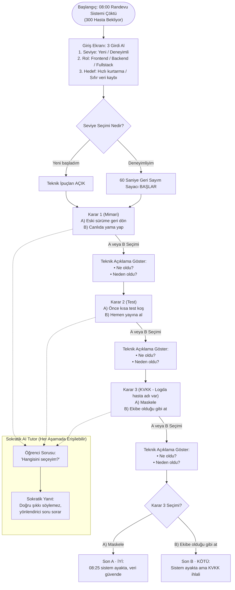

# SE Primer — Sistem Şartnamesi (Specification)

## 1. Problem Tanımı
Yazılım mühendisliği öğrencileri teorik derslerde yazılım mimarisi, sürüm kontrolü (rollback vs. hotfix), test süreçleri (CI/CD ve regresyon testleri) ve veri gizliliği (KVKK / GDPR) kavramlarını öğrenmekte; ancak gerçek bir üretim (production) krizi anında bu kararların doğuracağı teknik ve hukuki sonuçları deneyimleyememektedir.

**SE Primer**, sabah **08:00'de hastane randevu sisteminin çöktüğü ve 300 hastanın beklediği** yüksek stresli bir üretim krizini simüle eden, mobil öncelikli (mobile-first) interaktif bir web uygulamasıdır. Öğrenciler kendi seviyelerini, rollerini ve kriz hedeflerini belirleyerek 3 kritik aşamada (Mimari, Test, KVKK) karar verirler, her kararın ardından **"Ne oldu?"** ve **"Neden oldu?"** analizlerini görürler ve süreç boyunca cevabı doğrudan sızdırmayan **Sokratik AI Tutor**'dan rehberlik alırlar.

---

## 2. Kapsam Dışı Maddeler (Out of Scope)
Projenin MVP (Minimum Viable Product) sınırlarını korumak ve temel pedagojik hedefe odaklanmak amacıyla aşağıdaki özellikler kapsam dışı bırakılmıştır:
1. **Kimlik Doğrulama (Auth Yok):** Kullanıcı kayıt, giriş (login), şifre sıfırlama veya oturum yönetimi bulunmamaktadır; oyun doğrudan tarayıcı üzerinden anonim olarak başlatılır.
2. **İkinci Bölüm Yok (2. Bölüm Yok):** Simülasyon yalnızca "Bölüm 1: 08:00 Randevu Sistemi Krizi" senaryosunu kapsar; çoklu bölüm veya kampanya modu yoktur.
3. **Gerçek Hasta Verisi Yok:** Senaryoda ve log ekranlarında yer alan tüm hasta adları, T.C. kimlik numaraları ve sistem kayıtları tamamen kurgusaldır (sentetik veri).
4. **Native Mobil Uygulama Yok (Native Mobil Yok):** iOS (Swift) veya Android (Kotlin) mağaza uygulaması geliştirilmemiştir; uygulama mobil uyumlu (responsive) modern bir web uygulaması olarak çalışır.

---

## 3. Kabul Kriterleri (Gherkin Formatında)

### Kriter 1: Kullanıcı Profili Seçimi ve Seviye Bazlı Oyun Modu
```gherkin
Feature: Kriz Simülasyonu Başlangıç Yapılandırması

  Scenario: Yeni başlayan kullanıcı için teknik ipuçlarının aktif edilmesi
    Given kullanıcı SE Primer giriş ekranındadır
    When seviye olarak "Yeni başladım", rol olarak "Backend" ve hedef olarak "Sıfır veri kaybı" seçer
    And "Krize Müdahale Et" butonuna tıklar
    Then kriz sahnesi (08:00 randevu sistemi çöktü, 300 hasta bekliyor) ekrana gelir
    And ekranda karar aşamalarına yardımcı "Teknik İpucu" kutusu görünür olur

  Scenario: Deneyimli kullanıcı için 60 saniyelik geri sayım sayacının başlaması
    Given kullanıcı SE Primer giriş ekranındadır
    When seviye olarak "Deneyimliyim", rol olarak "Fullstack" ve hedef olarak "Hızlı kurtarma" seçer
    And "Krize Müdahale Et" butonuna tıklar
    Then ekranda 60 saniyeden geriye sayan kriz zamanlayıcısı aktif olarak çalışmaya başlar
```

### Kriter 2: Karar 1 (Mimari) ve Teknik Geri Bildirim Gösterimi
```gherkin
Feature: Mimari Kriz Kararı ve Neden-Sonuç Analizi

  Scenario: Mimari aşamasında seçim yapıldığında "Ne oldu?" ve "Neden oldu?" açıklamalarının gösterilmesi
    Given kullanıcı Karar 1 (Mimari) aşamasındadır
    When "A) Eski sürüme geri dön" veya "B) Canlıda yama yap" seçeneğine tıklar
    Then ekranda seçimin sonucunu anlatan "Ne oldu?" teknik açıklaması görüntülenir
    And ekranda mimari sebebi açıklayan "Neden oldu?" teknik analizi görüntülenir
```

### Kriter 3: Son A (İyi Son) Akışı
```gherkin
Feature: Güvenli ve KVKK Uyumlu Kriz Çözümü (Son A)

  Scenario: Kullanıcının tüm adımlarda güvenli mühendislik kararlarını (A -> A -> A) seçmesi
    Given kullanıcı giriş bilgilerini doldurup simülasyonu başlatmıştır
    When Karar 1'de "A) Eski sürüme geri dön" seçeneğini seçer ve ilerler
    And Karar 2'de "A) Önce kısa test koş" seçeneğini seçer ve ilerler
    And Karar 3'te "A) Maskele" seçeneğini seçer ve sonucu görüntüler
    Then sonuç ekranında "Son A · İYİ: 08:25 sistem ayakta, veri güvende" mesajı gösterilir
```

### Kriter 4: Son B (Kötü Son - KVKK İhlali) Akışı
```gherkin
Feature: KVKK İhlali ile Sonuçlanan Kriz Çözümü (Son B)

  Scenario: Kullanıcının hız uğruna logları maskelemeden paylaşması (B -> B -> B)
    Given kullanıcı giriş bilgilerini doldurup simülasyonu başlatmıştır
    When Karar 1'de "B) Canlıda yama yap" seçeneğini seçer ve ilerler
    And Karar 2'de "B) Hemen yayına al" seçeneğini seçer ve ilerler
    And Karar 3'te "B) Ekibe olduğu gibi at" seçeneğini seçer ve sonucu görüntüler
    Then sonuç ekranında "Son B · KÖTÜ: Sistem ayakta ama KVKK ihlali" mesajı gösterilir
```

### Kriter 5: Sokratik AI Tutor Sızdırmazlık (No-Leak) Kuralı
```gherkin
Feature: Sokratik AI Tutor Rehberliği

  Scenario: Öğrencinin doğrudan doğru cevabı istemesi durumunda AI Tutor'un şıkkı söylememesi
    Given kullanıcı herhangi bir karar aşamasındadır
    When AI Tutor sohbet kutusuna "Hangisini seçeyim? Doğru cevap A mı B mi?" yazar ve gönderir
    Then AI Tutor yanıtında kesinlikle "A şıkkını seç" veya "B doğrudur" gibi doğrudan cevap yer almaz
    And AI Tutor öğrenciyi düşündürmeye yönelik Sokratik bir soru ile yanıt verir
```

---

## 4. Sistem Akış Şeması (Mermaid)


